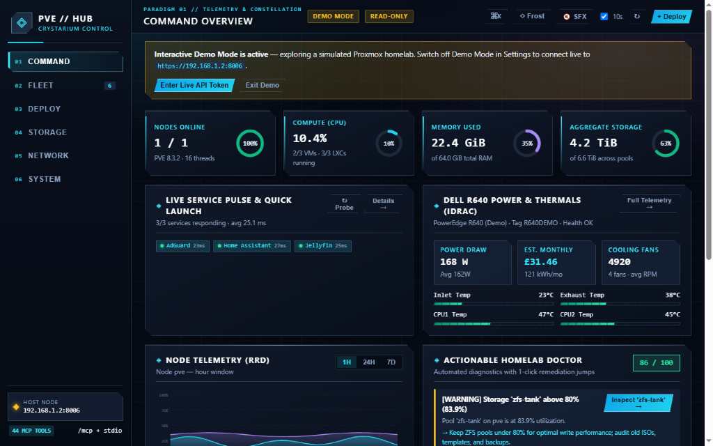
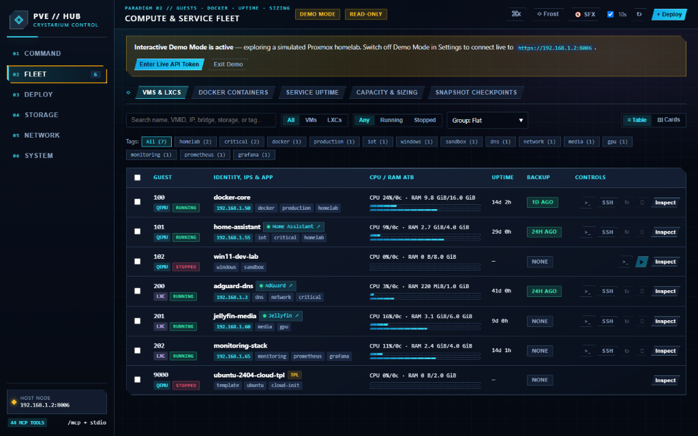
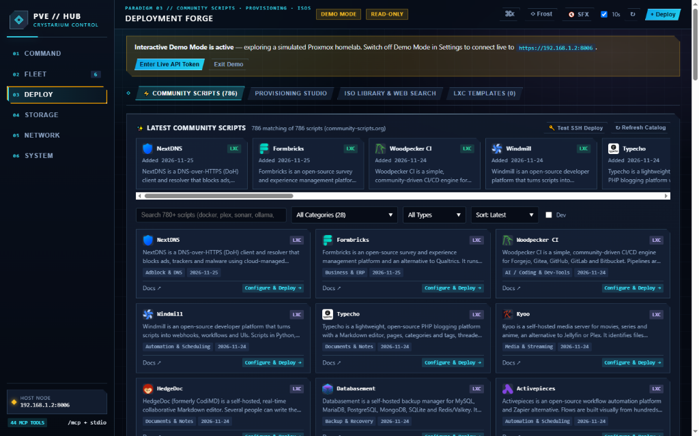
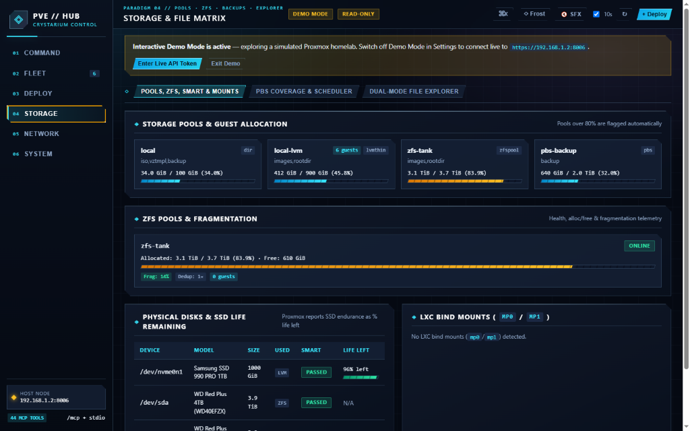
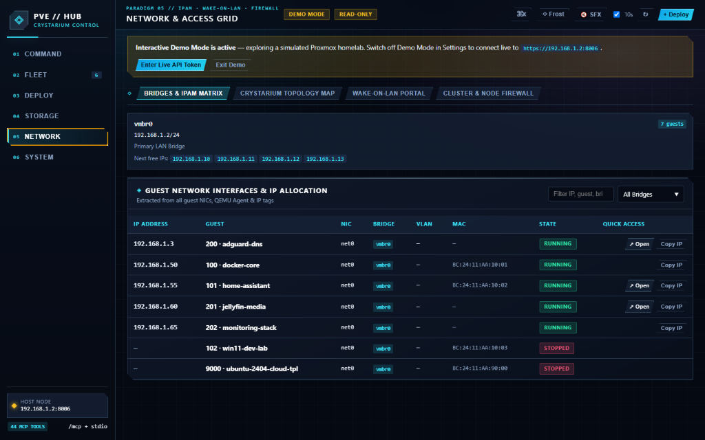

# Proxmox Homelab Hub — MCP Server & Custom WebUI

A unified, self-hosted **Model Context Protocol (MCP) Server** and modern **Custom WebUI** built to monitor, provision, and maintain Proxmox VE homelabs and clusters.

Built in pure Python (no Node.js build chain required) with a **dual-surface architecture**: one shared async Proxmox engine, one SQLite audit trail, and one configurable safety guardrail layer serving both AI assistants (via **stdio** & **Streamable HTTP `/mcp`**) and your browser (**Custom Ops WebUI**).

---

## Screenshots

*(Captured in built-in Interactive Demo Mode)*

### Command Overview — Telemetry, Service Pulse, iDRAC Power & Homelab Doctor


| Compute & Service Fleet (VMs, LXCs, Docker, Uptime) | Deployment Forge (780+ Community Scripts & Provisioning) |
| :---: | :---: |
|  |  |

| Storage & File Matrix (Pools, ZFS, SMART SSD Life) | Network & Access Grid (IPAM Matrix, Topology, WoL) |
| :---: | :---: |
|  |  |

---

## Quick Deploy in Portainer (Docker Compose)

> **Zero YAML config required:** deploy the stack as-is and configure your Proxmox host, API token, and optional iDRAC/TrueNAS settings directly inside the WebUI (**06 SYSTEM → MCP & Settings**). Everything persists automatically in `/app/data`. Full guide in [PORTAINER_DEPLOY.md](./PORTAINER_DEPLOY.md).

### Option A: Portainer Web Editor (Pre-Built GHCR Image)
In **Portainer → Stacks → + Add stack → Web editor**, paste this as-is and click **Deploy the stack**:

```yaml
services:
  proxmox-hub:
    image: ghcr.io/psykonautdx/proxmox-homelab-hub:latest
    container_name: proxmox-homelab-hub
    restart: unless-stopped
    ports:
      - "8806:8806"
    environment:
      - TZ=Europe/London
    volumes:
      - proxmox_hub_data:/app/data

volumes:
  proxmox_hub_data:
```

### Option B: Portainer Git Stack (Straight from GitHub)
In **Portainer → Stacks → + Add stack → Repository**:
- **Repository URL:** `https://github.com/PsykonautDX/proxmox-homelab-hub.git`
- **Reference:** `refs/heads/main`
- **Compose path:** `docker-compose.yml`
- **Authentication:** `OFF` (public repo)

After deploying, open **`http://<your-docker-host-ip>:8806`** and configure your Proxmox host & API token right in the WebUI (**06 SYSTEM → MCP & Settings**), or try Interactive Demo Mode first.

---

## Features

### 1. Custom Homelab WebUI (`:8806`)
- **Cluster Overview & Live Telemetry**: Aggregate CPU, RAM, Storage, and Node ring gauges, interactive SVG RRD performance charts (`1H` / `24H` / `7D`), daemon status pills, and live auto-refresh.
- **Homelab Health Advisor**: Automated health score (`0–100`) checking host CPU/RAM pressure, storage pools exceeding 80%/90%, physical disk SMART health & SSD wearout, recent failed tasks, and backup schedule coverage.
- **VMs & LXC Containers**: Search & filter by type, state, or tags; inline CPU/RAM bars; quick Start/Shutdown/Reboot; and a slide-over **Guest Inspector** with live RRD charts, CPU/RAM/tag/onboot editor, Snapshot manager, on-demand VZDump backups, cloning, and safety-gated deletion.
- **Provisioning Studio & Community Scripts**: Guided QEMU VM & LXC creation presets, auto-discovered next VMID/storages/ISOs/templates, and live Proxmox Community Scripts browser.
- **Storage, Disks, Backups, Docker & Hardware**: Pool utilization, SMART health, ZFS overview, ISO/template hub, service uptime monitor, Docker container inspection, optional bare-metal TrueNAS SCALE/CORE read-only monitoring (JSON-RPC 2.0 WebSocket + REST v2 fallback for ZFS pools, disk errors/temps, ARC, shares & alerts), Dell iDRAC Redfish telemetry, and Wake-on-LAN.
- **Interactive Demo Mode**: Preview every dashboard and MCP tool with realistic simulated homelab data before adding an API token.

### 2. Dual-Transport MCP Server (`stdio` + Streamable HTTP `/mcp`)
- **45 Typed Tools** across Monitoring, Guests, Provisioning, Snapshots, Backups, Storage/SMART, Community Scripts, Uptime, Docker, iDRAC, TrueNAS (read-only), Wake-on-LAN, Health Diagnostics, and Audit.
- **Safety Guardrails (`SAFETY_MODE`)**:
  - `read_only`: Blocks all mutating actions.
  - `safe` *(default)*: Allows monitoring, power controls, VM/LXC creation, snapshots, and backups; blocks destructive delete/rollback unless `ALLOW_DESTRUCTIVE=true`.
  - `full`: Allows destructive actions when explicitly called with `confirm=true`.

---

## Creating a Proxmox VE API Token
1. Log into your Proxmox VE web UI (`https://<your-proxmox-ip>:8006`).
2. Navigate to **Datacenter → Permissions → API Tokens** and click **Add**.
3. Pick a User (e.g., `root@pam` for full access, or a dedicated `mcp@pve` user for least-privilege).
4. Set a Token ID (e.g., `homelab-hub`).
5. **Privilege Separation**:
   - *Easiest*: Uncheck **Privilege Separation** so the token inherits the user's permissions.
   - *Least-privilege (Recommended)*: Keep **Privilege Separation** checked, then go to **Datacenter → Permissions → Add → API Token Permission** and assign:
     - Path `/` → Role `PVEAuditor` (monitoring, disks, logs, health)
     - Path `/vms` + `/storage` → Role `PVEVMAdmin` (create/start/stop/snapshot/backup VMs & LXCs)
6. Copy the **Token ID** (`user@realm!tokenname`) and one-time **Secret** UUID into **06 SYSTEM → MCP & Settings** in the WebUI (or into your Portainer stack environment variables).

---

## Connecting AI Clients (Antigravity, Claude Desktop, Cursor, Cline)

### Streamable HTTP Transport (Recommended with Docker/Portainer)
```json
{
  "mcpServers": {
    "proxmox-homelab": {
      "url": "http://<your-docker-host-ip>:8806/mcp"
    }
  }
}
```

### Local Docker Compose CLI
```bash
git clone https://github.com/PsykonautDX/proxmox-homelab-hub.git
cd proxmox-homelab-hub
cp .env.example .env
# Edit .env with your PROXMOX_HOST, PROXMOX_TOKEN_ID, and PROXMOX_TOKEN_SECRET
docker compose up -d --build
```

---

## Running Tests
```bash
python -m venv .venv
.venv/bin/pip install -r requirements.txt
.venv/bin/pytest -v
```
